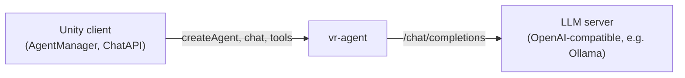

# VR Agent

Optional. LLM-backed conversational agents for Va.Si.Li-Lab: the Unity client creates agents, sends them what the user
said and runs the tool calls they answer with.

Source: `vr-agent/` · Python, FastAPI



## How it works

- Each agent has an ID, a system prompt, its own tool list and a conversation history (the last 10 messages are sent
  to the LLM).
- Unity registers the tools it offers (`[AgentTool]` methods) with `/toolDescriptions`. Each agent starts with a copy
  of that registry; `/addTool` and `/removeTool` change an agent's own list.
- `/chat` sends the user's message together with the agent's tools to the LLM. A reply is either plain text or a
  tool call; tool calls are returned to Unity, which executes them in the scene.
- Agents live in memory only. A restart forgets all agents; a `/chat` for an unknown ID creates a new agent with a
  default prompt.

## Endpoints

All `POST`, JSON bodies.

| Endpoint | Body | Purpose |
|---|---|---|
| `/createAgent` | `{"id": "...", "systemPrompt": "..."}` | Create (or replace) an agent |
| `/chat` | `{"id": "...", "message": "..."}` | Send a user message; returns `{"reply", "is_tool", "agent_status"}` |
| `/toolDescriptions` | JSON string with a list of `{"name", "description", "parameters"}` | Register the tools Unity offers |
| `/addTool` | `{"id": "...", "tool_name": "..."}` | Allow a registered tool for one agent |
| `/removeTool` | `{"id": "...", "tool_name": "..."}` | Remove a tool from one agent |

When `is_tool` is `true`, `reply` holds the tool call as JSON.

!!! warning "No authentication"
    The endpoints are not authenticated. Don't expose the service beyond the network the clients run in.

## Configuration

| Variable | Default (Dockerfile) | Purpose |
|---|---|---|
| `API_BASE` | `http://host.docker.internal:11434/v1` | OpenAI-compatible API of the LLM server |
| `API_KEY` | `ollama` | Bearer token for the LLM server |
| `MODEL_NAME` | `gpt-oss:20b` | Model to use |

Without the Dockerfile, `app.py` falls back to the TTLab LLM server. Always set the three variables explicitly.

## Running

```bash
cd vr-agent
docker build -t vasili/vr-agent .
docker run -d --restart unless-stopped -p 8000:8000 \
    -e API_BASE=http://<llm host>:11434/v1 -e API_KEY=<key> -e MODEL_NAME=gpt-oss:20b \
    vasili/vr-agent
```

!!! note "The service listens on port 8000"
    The Dockerfile declares `EXPOSE 5000`, but the server binds to `0.0.0.0:8000`. Publish port 8000.

Without `--server`, `python app.py` starts an interactive terminal chat with a test agent instead.

## Unity client

Set `agent` in the client's endpoints configuration (`VasiliEndpoints`) to this service's URL. See
[Bots](https://texttechnologylab.github.io/Va.Si.Li-Lab/modules/bots/) in the Va.Si.Li-Lab documentation. Speech in and
out for the agents comes from [TTS/STT](tts_stt.md).
